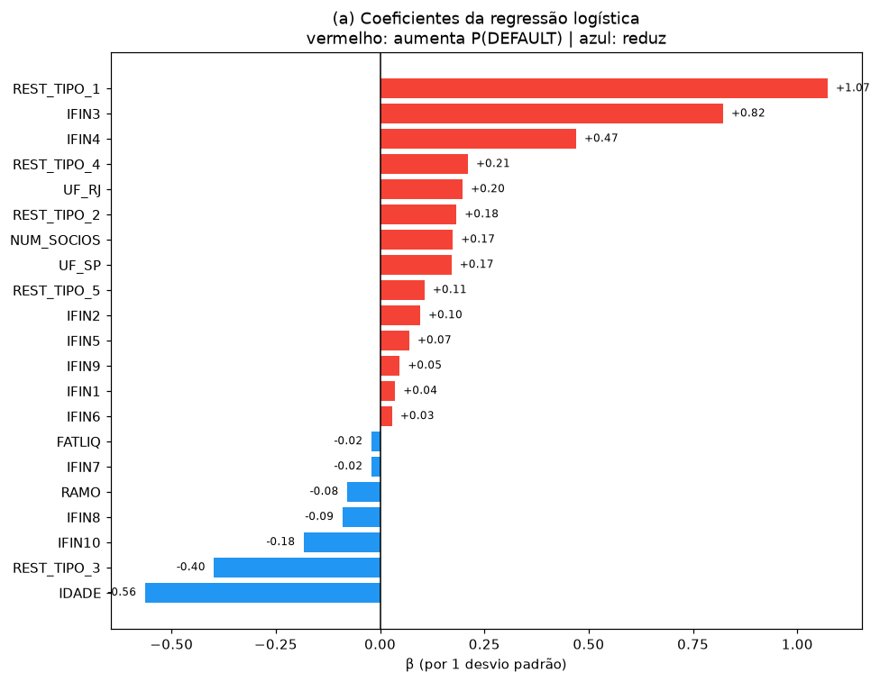
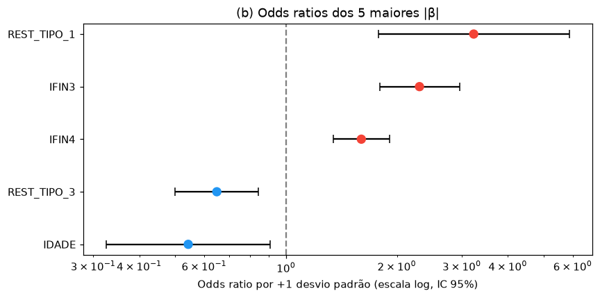
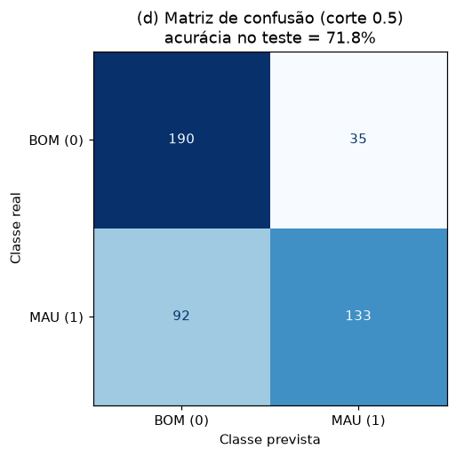
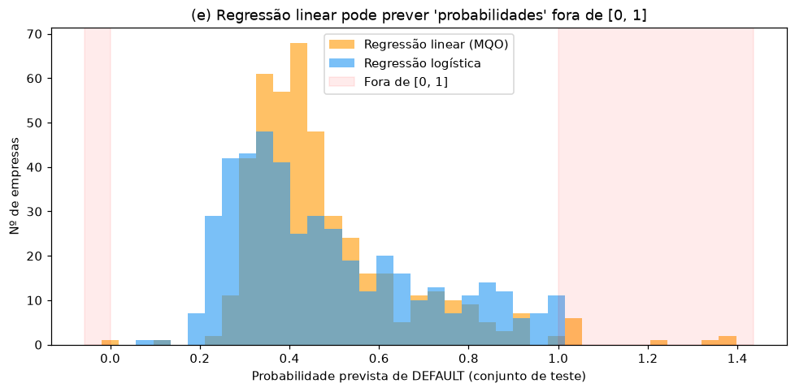
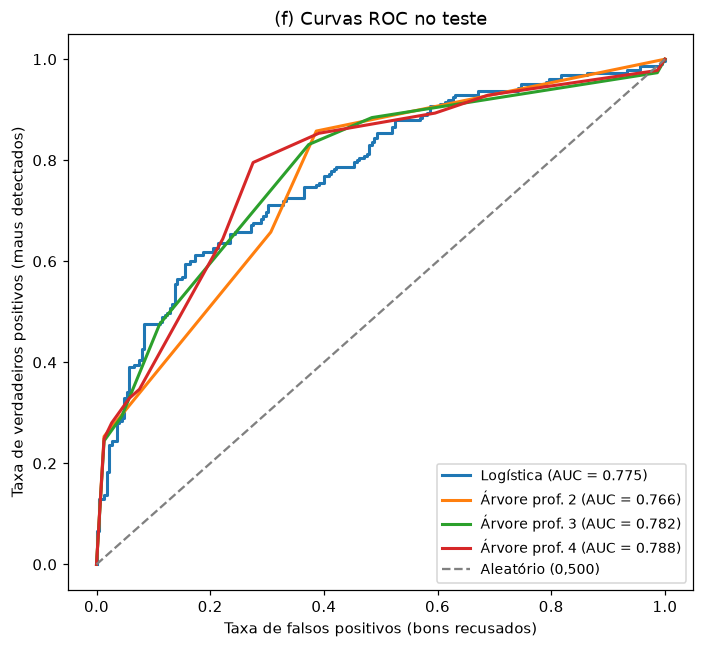
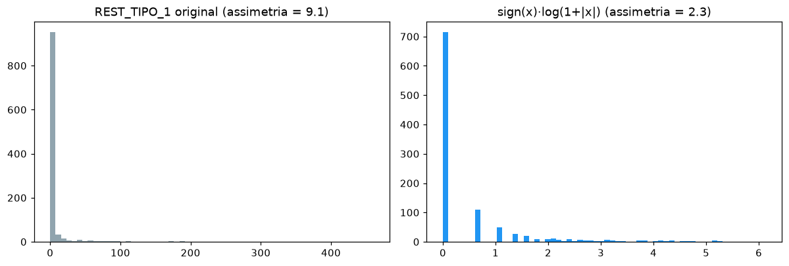
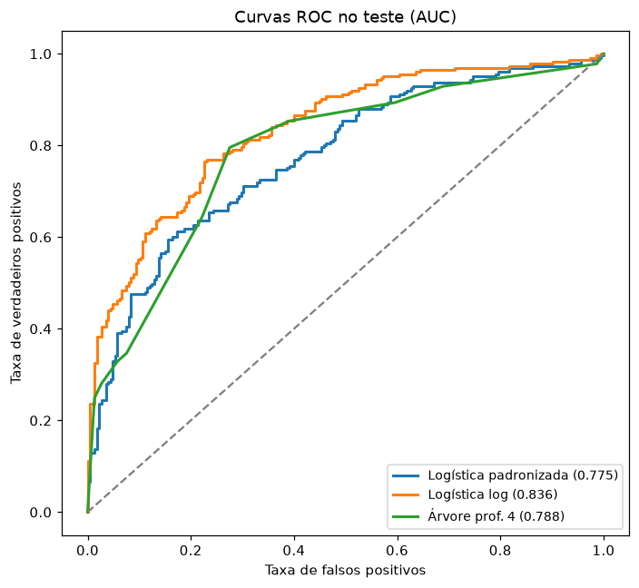
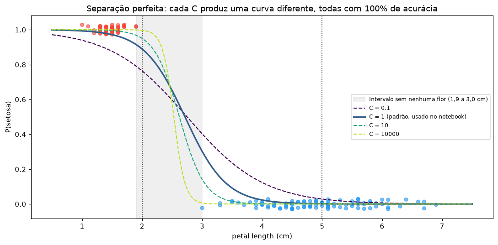

# Regressão Logística: Inadimplência de Empresas e Iris

Regressão logística aplicada a dois problemas. O principal é prever a inadimplência de 1.500 empresas, a mesma base do projeto de árvores de decisão, o que permite comparar os dois métodos. O segundo usa a base Iris para mostrar a mecânica da função sigmoide e o que acontece quando as classes são perfeitamente separáveis.

## Principais resultados

- **O modelo logístico supera o baseline com folga:** 71,8% de acurácia e AUC de 0,775 no teste, contra 50% do baseline. Os maiores efeitos são de `REST_TIPO_1` (desabonos do cliente) e `IFIN3`: cada desvio padrão a mais multiplica as chances de inadimplência por cerca de 3,2 e 2,3, respectivamente.
- **Com o corte de 0,5, o modelo aprova muitos maus pagadores:** detecta só 59% dos inadimplentes. Como esse é o erro mais caro em crédito, o ponto de corte precisa ser ajustado.
- **A logística perde para a árvore em acurácia, mas por um motivo corrigível.** Vários indicadores têm caudas muito longas, e a logística é sensível a isso. Aplicando um logaritmo com sinal, a AUC sobe de 0,775 para **0,836** no teste (0,753 → 0,801 em validação cruzada), acima de todas as árvores (~0,75 em CV).
- **Na Iris, setosa é perfeitamente separável por `petal length`,** e por isso os coeficientes da logística não têm um valor "verdadeiro". O 88,9% de probabilidade em 2 cm depende da regularização escolhida.

## Estrutura do projeto

```
regressao-logistica/
├── data/
│   └── base_pejota.xls            
├── src/
│   ├── config.py                  # caminhos, semente, corte, C, custos dos erros
│   ├── data.py                    # leitura, limpeza e divisão treino/teste
│   ├── preprocessing.py           # pipelines: imputação, padronização, log, one-hot
│   ├── q9_inadimplencia.py        
│   ├── q9_complementos.py         # caudas longas, validação cruzada, custo dos erros
│   ├── q10_iris.py                
│   └── utils.py                   # salvar tabelas e figuras
├── tests/
│   └── test_logistica.py          # pré-processamento e propriedades usadas na análise
├── results/
│   ├── figures/                   # gráficos usados neste README
│   └── tables/                    # tabelas em CSV e o summary do statsmodels
├── main.py
├── requirements.txt
└── README.md
```

O arquivo central é `preprocessing.py`. Ele monta, em um `Pipeline` do scikit-learn, as três variações de pré-processamento usadas no projeto:

- `padrao`: imputação pela mediana e padronização, igual ao notebook;
- `log`: aplica sign(x)·log(1+|x|) antes de padronizar;
- `nenhuma`: só imputação, usada nas árvores, que não precisam de padronização.

Como tudo fica dentro do pipeline, a mediana, a média e o desvio padrão são aprendidos só com o treino. Na validação cruzada, só com os folds de treino. A divisão treino/teste usa a mesma semente e estratificação do projeto de árvores, então os conjuntos de teste são idênticos e a comparação do item (f) é direta.

Os módulos `q9_*` e `q10_*` imprimem as respostas no terminal e salvam tabelas e figuras em `results/`.

---

## Inadimplência com regressão logística

A base tem 1.500 empresas, 50% inadimplentes, com 21 preditores após o one-hot de `UF`. O pré-processamento é o mesmo do projeto de árvores: brancos viram ausentes, a imputação usa a mediana do treino, e `COD_CLI` e `STATUS` ficam de fora. A divisão é 70% treino (1.050) e 30% teste (450), estratificada.

### (a) Modelo e coeficientes

Os preditores são padronizados com a média e o desvio do treino. Assim, cada coeficiente β é o efeito de **+1 desvio padrão** no log-odds de inadimplência, e os coeficientes podem ser comparados entre si.



O modelo como um todo é significativo (teste de razão de verossimilhança, p ≈ 2 × 10⁻³⁶), com pseudo-R² de McFadden de 0,155. Sete preditores são significativos a 5%: `REST_TIPO_1`, `IFIN3`, `IFIN4`, `IDADE`, `REST_TIPO_3`, `NUM_SOCIOS` e `UF_RJ`. O summary completo está em `results/tables/q9a_summary_statsmodels.txt`.

- **Aumentam o risco:** principalmente `REST_TIPO_1` (+1,07), `IFIN3` (+0,82) e `IFIN4` (+0,47).
- **Reduzem o risco:** principalmente `IDADE` (−0,56) e `REST_TIPO_3` (−0,40).

O modelo do scikit-learn usa regularização L2 leve (`C = 1`, o padrão). Os p-valores e intervalos de confiança vêm de um ajuste sem penalização no statsmodels, com os mesmos dados. Nos coeficientes principais, os dois diferem em menos de 10%.

### (b) Odds ratios dos 5 maiores |β|

| Variável | β | OR | IC 95% do OR | p-valor |
|---|---|---|---|---|
| `REST_TIPO_1` | +1,07 | 3,23 | 1,78 a 5,87 | < 0,001 |
| `IFIN3` | +0,82 | 2,30 | 1,79 a 2,96 | < 0,001 |
| `IDADE` | −0,56 | 0,54 | 0,33 a 0,91 | 0,019 |
| `IFIN4` | +0,47 | 1,60 | 1,34 a 1,91 | < 0,001 |
| `REST_TIPO_3` | −0,40 | 0,65 | 0,50 a 0,84 | 0,001 |

*β do scikit-learn; OR e IC do ajuste sem penalização.*



O OR é o fator que multiplica as **chances** de inadimplência, p/(1−p), quando a variável aumenta 1 desvio padrão e as demais ficam constantes.

- **`REST_TIPO_1` (OR = 3,2):** cada desvio padrão a mais de desabonos do cliente multiplica as chances de inadimplência por cerca de 3. É o histórico de pagamento recente da empresa. Na base, a inadimplência vai de 38% entre as empresas sem desabonos a 85% entre as que têm três ou mais.
- **`IFIN3` (OR = 2,3):** o dicionário não informa o que ele mede, então a interpretação fica no sentido do efeito: valores maiores, mais risco.
- **`IFIN4` (OR = 1,6):** cerca de 70% das empresas têm `IFIN4` = 0, com 39% de inadimplência. Entre as que têm valor positivo, a inadimplência é de 73%.
- **`IDADE` (OR = 0,54):** empresas mais antigas são mais seguras. Entre as com até 22 meses, a inadimplência é de 61%; acima de 44 meses, 42%. Empresas que sobreviveram mais tempo já passaram por ciclos econômicos e costumam ter relações de crédito estabelecidas.

**Dois cuidados de leitura:**

- **`REST_TIPO_3` tem OR < 1, mas isso não significa que esse tipo de restrição reduz o risco.** Isoladamente, ele está associado a *mais* inadimplência: 43% sem restrição contra 64% com pelo menos uma. O sinal negativo é um efeito parcial, porque `REST_TIPO_3` tem correlação de 0,44 com `REST_TIPO_1`. Para empresas com o mesmo número de desabonos do tipo 1, ter também desabonos do tipo 3 está associado a um risco um pouco menor. É o mesmo fenômeno de inversão de sinal visto com `Enroll` no projeto de regularização. No modelo com logaritmo (análise complementar 1), o coeficiente encolhe de −0,40 para −0,10.
- **O "desvio padrão" de `IDADE` é distorcido por um único valor.** Uma empresa tem `IDADE` = 2.007 meses (~167 anos), o que leva o desvio padrão a ~54 meses. Sem esse valor, ele seria ~18. O OR de 0,54 corresponde, portanto, a um aumento de idade bem maior do que parece.

### (c) Acurácia e baseline

| | Acurácia |
|---|---|
| Treino | 70,8% |
| Teste | 71,8% |
| Baseline (sempre a classe majoritária) | 50,0% |

A acurácia no teste é próxima da do treino, então não há sinal de overfitting. Isso é esperado para um modelo linear com 21 parâmetros e 1.050 observações. Como a base é balanceada, o baseline é 50%, e o modelo acerta 21,8 pontos a mais que um classificador sem informação.

### (d) Matriz de confusão



| | Previsto BOM | Previsto MAU |
|---|---|---|
| **Real BOM** | 190 | 35 |
| **Real MAU** | 92 | 133 |

Com corte 0,5, **o modelo erra mais aprovando maus pagadores** (92 falsos negativos) do que recusando bons (35 falsos positivos). Ele detecta só 59% dos inadimplentes. Por outro lado, quando prevê MAU, acerta 79% das vezes.

### (e) Por que não usar regressão linear?

A regressão linear modela P(DEFAULT) como uma combinação linear sem limites, e por isso pode prever valores abaixo de 0 ou acima de 1, que não são probabilidades. A regressão logística aplica a função sigmoide ao preditor linear:

$$P(\text{DEFAULT}=1 \mid X) = \frac{1}{1 + e^{-(\beta_0 + \beta_1 x_1 + \cdots + \beta_p x_p)}}$$

O resultado fica sempre entre 0 e 1. Os coeficientes passam a ter interpretação multiplicativa nas chances (odds ratios), e o modelo é ajustado por máxima verossimilhança, que é o critério adequado para uma resposta binária.

Isso não é só teórico. Ajustando uma regressão linear com os mesmos dados, **11 das 450 empresas do teste recebem "probabilidade" fora de [0, 1]**, com máximo de 1,385.



### (f) Comparação com as árvores de decisão

Mesma divisão treino/teste do projeto de árvores:

| Modelo | Acurácia teste | AUC teste |
|---|---|---|
| Regressão logística | 71,8% | 0,775 |
| Árvore profundidade 2 | 73,6% | 0,766 |
| Árvore profundidade 3 | 72,9% | 0,782 |
| Árvore profundidade 4 | 76,0% | 0,788 |
| Baseline | 50,0% | 0,500 |



Em acurácia, todas as árvores superam a logística nesta divisão. Em AUC, que mede a capacidade de ordenar as empresas por risco independentemente do corte, a diferença é pequena (0,766 a 0,788 contra 0,775). Para crédito, a AUC costuma importar mais, porque o corte é depois ajustado aos custos.

As duas abordagens têm vantagens diferentes. A logística dá o efeito de cada variável com intervalo de confiança e produz probabilidades suaves, que são boas para ordenar clientes. A árvore captura limiares e interações automaticamente, como "IFIN3 alto **e** dois ou mais desabonos", e é mais fácil de explicar como uma sequência de regras.

A próxima seção mostra que a desvantagem da logística em acurácia vem, em boa parte, da forma das variáveis, e não do método.

---

## Análises complementares da Questão 9

### 1. Caudas longas prejudicam a logística

Vários preditores são muito assimétricos. Em `IFIN2`, `IFIN1` e `IFIN7`, o máximo é centenas de vezes maior que a mediana. Para a árvore isso não importa, porque ela só compara cada valor com um limiar. Para a logística, importa: o efeito de cada variável é linear no log-odds. Um valor 900 vezes maior que o típico gera um log-odds absurdo, e a padronização não ajuda, porque o próprio desvio padrão fica inflado pelos extremos.

A transformação sign(x)·log(1+|x|) comprime as caudas, preserva a ordem e aceita zeros e negativos, que são comuns nos `IFIN`:



| Modelo | Acurácia CV | AUC CV | Acurácia teste | AUC teste |
|---|---|---|---|---|
| Logística padronizada (notebook) | 69,1% | 0,753 | 71,8% | 0,775 |
| **Logística com log** | 71,6% | **0,801** | 74,4% | **0,836** |
| Árvore profundidade 2 | 72,1% | 0,751 | 73,6% | 0,766 |
| Árvore profundidade 3 | 71,2% | 0,754 | 72,9% | 0,782 |
| Árvore profundidade 4 | 70,4% | 0,756 | 76,0% | 0,788 |

*CV: validação cruzada estratificada de 10 folds, só no treino. Erro padrão da AUC em CV: ~0,01 a 0,015.*



Com o logaritmo, a logística passa a ter a **maior AUC**, com uma diferença de ~0,05 sobre as árvores em CV, bem acima do erro padrão. Em acurácia de CV, fica empatada com as árvores. Os coeficientes também ficam mais coerentes. Variáveis que antes eram "achatadas" pelos extremos, como `IFIN2` (0,10 → 0,35) e `REST_TIPO_5` (0,11 → 0,28), passam a contribuir. Os efeitos inflados por poucos valores extremos, como `IDADE` (−0,56 → −0,24) e `REST_TIPO_3` (−0,40 → −0,10), diminuem.

### 2. Ponto de corte considerando o custo dos erros

Com a mesma premissa do projeto de árvores, em que aprovar um mau pagador custa 5 vezes mais que recusar um bom, o corte que minimiza o custo esperado é 1/(1+5) ≈ 0,17. Usando a logística com log:

| Corte | Bons recusados | Maus aprovados | Acurácia | Custo (FP + 5·FN) |
|---|---|---|---|---|
| 0,50 | 49 | 66 | 74,4% | 379 |
| 0,40 | 71 | 42 | 74,9% | 281 |
| 0,30 | 99 | 27 | 72,0% | 234 |
| 0,17 | 152 | 8 | 64,4% | **192** |

O corte mais baixo reduz os maus aprovados de 66 para 8 e o custo em 49%. Isso mostra a vantagem das probabilidades contínuas da logística: o corte pode ser ajustado em qualquer ponto. A árvore de profundidade 4 tem no máximo 16 folhas, e portanto poucos cortes possíveis.

---

## Questão 10: setosa × demais (Iris, só `petal length`)

### Ajuste e cálculo da sigmoide

Com o scikit-learn (`C = 1`): b₀ = 7,9224 e b₁ = −2,9193 (OR = 0,054). Cada centímetro a mais de pétala multiplica as chances de ser setosa por 0,054, ou seja, as reduz em ~95%.

| `petal length` | z = b₀ + b₁·x | P(setosa) = 1/(1+e⁻ᶻ) |
|---|---|---|
| 2 cm | 7,9224 − 2,9193·2 = 2,0837 | **0,889** |
| 5 cm | 7,9224 − 2,9193·5 = −6,6743 | **0,001** |

Uma pétala de 2 cm indica alta probabilidade de setosa, e uma de 5 cm praticamente exclui a espécie. A probabilidade cai de 0,97 em 1,5 cm para 0,02 em 4 cm, e a fronteira de decisão (P = 0,5) fica em 2,71 cm. A acurácia no conjunto completo é de 100%.

### A separação é perfeita, não "quase perfeita"

A maior pétala de setosa mede 1,9 cm, e a menor das outras espécies, 3,0 cm. Não há nenhuma flor entre esses valores. Nessa situação, chamada de **separação completa**, o estimador de máxima verossimilhança **não existe**. Sempre é possível aumentar a verossimilhança deixando a curva mais íngreme, e os coeficientes tendem a infinito. O statsmodels sinaliza isso: o ajuste não converge e emite `PerfectSeparationWarning`, com erros padrão na casa de 10⁵.

O scikit-learn devolve números finitos só porque aplica regularização L2 por padrão. Esses números dependem diretamente da força da regularização:

| C | b₁ | OR | Fronteira (cm) | P(setosa \| 2 cm) | Acurácia |
|---|---|---|---|---|---|
| 0,1 | −1,57 | 0,209 | 2,75 | 0,764 | 100% |
| **1 (padrão)** | **−2,92** | **0,054** | **2,71** | **0,889** | 100% |
| 10 | −4,75 | 0,009 | 2,62 | 0,950 | 100% |
| 10.000 | −10,68 | 0,000 | 2,53 | 0,997 | 100% |



Todas as curvas classificam as 150 flores corretamente, mas atribuem probabilidades bem diferentes a 2 cm, que fica justamente na faixa vazia entre as espécies. O dado não informa quão rápida é a transição, porque não há nenhuma flor ali. Quem decide é a regularização. Por isso, o 88,9% deve ser lido como "alta probabilidade, segundo este modelo regularizado", e não como uma estimativa precisa. A classificação, por outro lado, é robusta: em todos os valores de C da tabela, a fronteira fica entre 2,5 e 2,75 cm, dentro da faixa vazia.

### Por que 1 variável basta na Iris e não na base de crédito

Na Iris, as classes **não se sobrepõem** em `petal length`: uma única regra classifica tudo. Na base de crédito, nenhuma variável separa bons e maus pagadores. A melhor delas, `IFIN3`, deixa 30% de inadimplentes de um lado e 69% do outro. Inadimplência depende de vários fatores combinados (situação financeira, histórico de pagamento, porte, idade da empresa) e tem um componente imprevisível que nenhum modelo elimina. Mesmo com 21 variáveis, a acurácia fica em torno de 72% a 76%. A setosa, ao contrário, é uma espécie morfologicamente distinta das outras duas, e a diferença aparece em uma única medida.

---

## Ferramentas

Python, scikit-learn, statsmodels, pandas, NumPy, Matplotlib, xlrd e pytest.
